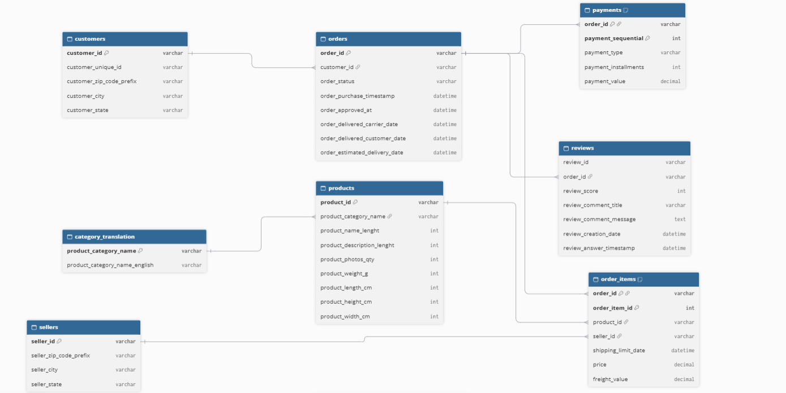
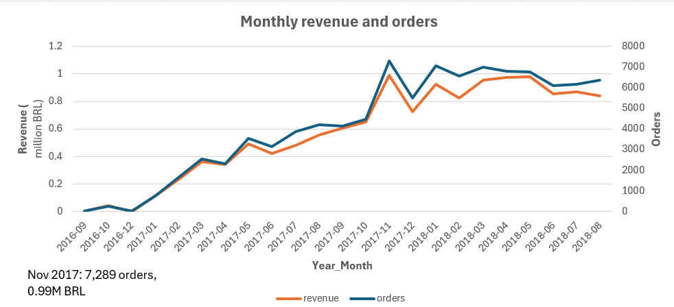
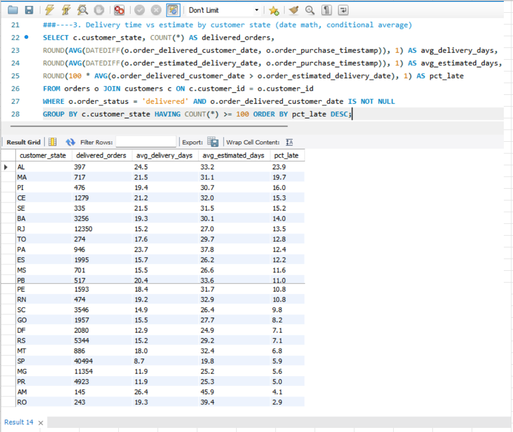
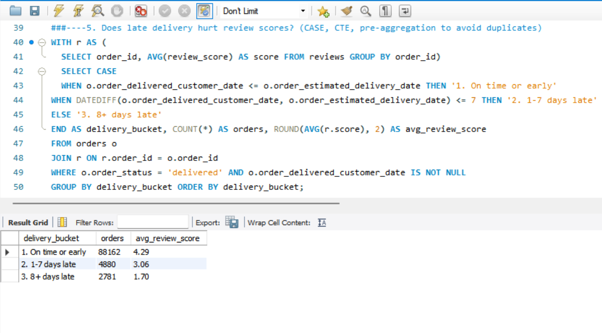
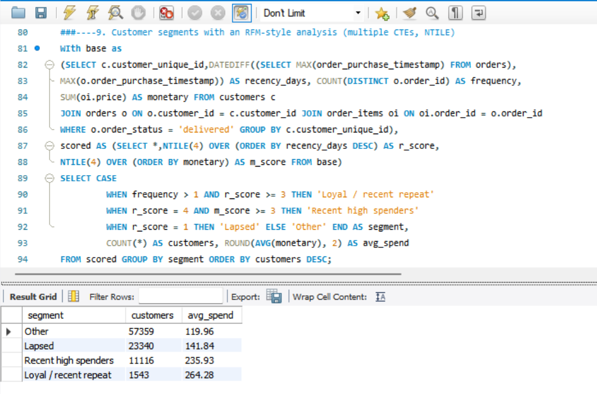

# E-commerce Sales & Delivery SQL Analysis (MySQL)

## Business question
How is the marketplace performing, and how do delivery and customer behavior affect revenue and satisfaction?
## Data
Olist Brazilian E-Commerce dataset (Kaggle), about 100K orders from 2016 to 2018.
Source: (https://www.kaggle.com/datasets/olistbr/brazilian-ecommerce). Raw files are not included because of size.
Currency is Brazilian reals (BRL).
## Tools
MySQL 8, MySQL Workbench, Excel (chart)
## Schema

`customer_id` is created per order; `customer_unique_id` identifies the actual customer,
so repeat-customer analysis uses `customer_unique_id`.
## Rules
- Revenue = sum of item price (excluding freight).
- Only orders with status "delivered" are counted unless stated.
- Reviews were pre-aggregated per order to avoid duplicates.
- ## SQL skills used
Multi-table joins, CTEs, window functions (LAG, RANK, NTILE, SUM OVER), CASE, date functions,
conditional aggregation, HAVING.
## Analysis

### 1. Monthly revenue and orders

**Insight:** Monthly orders grew from under 1,000 in January 2017 to a peak of 7,289 in
November 2017 (about 0.99M BRL), likely reflecting Black Friday, then held at roughly 6,000 to
7,000 a month through 2018. Revenue per order stayed in a narrow band, so growth came from volume.
### 3. Delivery time vs estimate by state

**Insight:** Delivery performance varies sharply by region. The large southeastern and southern
markets are fastest and most reliable: São Paulo (SP) averages 8.7 days with 5.9% late, and Minas
Gerais (MG) and Paraná (PR) average 11.9 days with about 5% to 5.6% late. The northeastern
states have the highest late rates: Alagoas (AL) 23.9%, Maranhão (MA) 19.7%, Piauí (PI) 16.0%,
Ceará (CE) 15.3% and Sergipe (SE) 15.2%, with deliveries taking 19 to 25 days. Estimates are
conservative everywhere (actual delivery is roughly 9 to 20 days faster than estimated on
average). The states with the highest late rates tend to have the thinnest cushion between
estimate and actual time (for example, AL has about 8.7 days, versus 13 to 14 days in MG and PR).
Rio de Janeiro (RJ) stands out for volume: it is the second-largest market (12,350 delivered
orders) with a 13.5% late rate. Amazonas (AM) and Rondônia (RO) have the longest delivery times
but low late rates (4.1% and 2.9%) because their estimates are very generous. States with
fewer than 100 delivered orders were excluded.

### 5. Does late delivery hurt review scores?

**Insight:** Late delivery has a large association with customer satisfaction. Orders delivered on
time or early average a 4.29 review score. Orders 1-7 days late drop to 3.06, and orders 8+ days
late average just 1.70, a gap of about 2.6 points. About 8% of delivered orders (7,661 of
95,823) arrived after the estimated date. Even a delay of less than a week costs roughly 1.2
points, so reducing small delays matters as much as eliminating long ones.

### 9. Customer segments (recency and spend)

**Insight:** Repeat buying is rare: only 1,543 customers (about 1.7% of the 93K analyzed) are
recent repeat buyers. They are also the highest spenders, at an average of 264 BRL, about 2.2
times the 120 BRL average of the "Other" group. Recent high spenders (11.9% of customers) average
236 BRL. Lapsed customers (the least recent quartile) still average 142 BRL, above the
"Other" group, which makes them a reasonable win-back target. Segment sizes for "Lapsed" and
"Recent high spenders" partly reflect the quartile cut-offs used in the scoring, so the
average-spend comparison is more informative than the segment sizes.

### 2.Top 10 categories by revenue
**Question:** Top 10 categories by revenue
	Health & beauty leads (1.23M BRL); watches & gifts has the highest revenue per order (about 212 BRL)
**Insight:** Health & beauty is the top category by revenue (1.23M BRL), followed by watches & gifts
(1.17M) and bed, bath & table (1.02M). The ranking by revenue differs from the ranking by order
volume: bed, bath & table has the most orders (9,272) but only the third-highest revenue, because
its average order value is low (about 110 BRL). Watches & gifts ranks second in revenue with only
5,495 orders, thanks to the highest revenue per order of any top-10 category (about 212 BRL).
Cool stuff (about 172 BRL) and auto (about 152 BRL) are also high-value categories despite
smaller order counts. The top 10 categories together generate about 8.25M BRL.

### 4. Late delivery rate by seller
**Question:** Which sellers are late most often?

| Seller (ID shortened) | Orders | % late |
|---|---|---|
| 54965bbe... | 73 | 30.1 |
| a49928bc... | 96 | 26.0 |
| beadbee3... | 64 | 25.0 |
| 06a2c3af... | 389 | 23.1 |
| cac4c8e7... | 74 | 23.0 |

**Insight:** Among sellers with at least 50 orders, the ten worst have late rates of 21% to 30%,
roughly three times the marketplace-wide rate of about 8%. One seller (06a2c3af...) stands out
for volume: 389 orders at a 23.1% late rate, or about 90 late orders, more than any other seller in
the list. Taken together, these ten sellers account for only about 250 late orders, around 3% of
all late deliveries, so seller performance alone does not explain the late-delivery problem: it is
spread across many sellers and the regional factors seen in Query 3.
### 6. Repeat vs one-time customers
**Question:** How many customers come back?

| Customer type | Customers | Share |
|---|---|---|
| One-time | 90,557 | 97.0% |
| Repeat | 2,801 | 3.0% |

**Insight:** 97% of customers placed only one delivered order. Just 3.0% (2,801 of 93,358)
bought more than once. Retention is the weak point: the plateau in monthly orders during
2018 (Query 1) means growth depends on constantly acquiring new customers rather than on
returning ones. Raising the repeat rate by a single percentage point would add roughly 930 repeat
customers.
Note: The "Loyal / recent repeat" segment in Query 9 (1,543 customers, 1.7%) is the subset of the
2,801 repeat customers (3.0%) who also bought recently.
### 7. Month-over-month revenue growth
| Month | Revenue (BRL) | MoM growth |
|---|---|---|
| 2017-02 | 234,223 | +109.5% |
| 2017-03 | 359,199 | +53.4% |
| 2017-05 | 489,338 | +43.6% |
| 2017-08 | 554,700 | +15.2% |
| 2017-11 | 987,765 | +52.4% |
| 2017-12 | 726,033 | -26.5% |
| 2018-01 | 924,645 | +27.4% |
| 2018-05 | 977,545 | +0.4% |
| 2018-08 | 838,577 | -3.4% |

**Insight:** Revenue grew quickly through 2017, rising from 234K BRL in February to a peak of
988K in November 2017 (+52.4% in one month, likely Black Friday), followed by a 26.5% drop in
December. In 2018 growth stalled: revenue moved within a range of roughly 826K to 978K BRL, peaked
in May 2018 at 978K, and by August was about 14% below that peak (839K BRL).

Note: growth rates before February 2017 are not meaningful because monthly revenue was tiny
(for example 135 BRL in September 2016) and November 2016 has no data, so those rows are excluded
from the table.
### 8. Top 3 sellers per state
**Question:** Who are the leading sellers in each state, and how concentrated is revenue?

| State | Rank 1 revenue (BRL) | Rank 2 revenue (BRL) | Rank 3 revenue (BRL) |
|---|---|---|---|
| BA | 217,940 | 17,522 | 12,656 |
| ES | 24,487 | 6,788 | 4,354 |
| DF | 18,381 | 9,815 | 9,386 |
| CE | 7,846 | 6,384 | 2,628 |

**Insight:** Seller revenue is highly concentrated within states. In Bahia (BA) the top seller earned
about 218K BRL, roughly 12 times the second-ranked seller (17.5K), and in Espírito Santo (ES)
the leader earned about 3.6 times the runner-up. Other states are more evenly spread, with the
top two sellers in Ceará (CE) within about 20% of each other. Some states depend on very few
sellers: Amazonas (AM) has only one ranked seller (1,177 BRL).
### 10. Payment type share and installments
**Question:** How do customers pay, and how much do installments matter?

| Payment type | Orders | Total value (BRL) | Share of value | Avg installments |
|---|---|---|---|---|
| Credit card | 76,505 | 12.54M | 78.3% | 3.5 |
| Boleto | 19,784 | 2.87M | 17.9% | 1.0 |
| Voucher | 3,866 | 0.38M | 2.4% | 1.0 |
| Debit card | 1,528 | 0.22M | 1.4% | 1.0 |

**Insight:** Credit cards dominate, handling 78.3% of payment value, with customers splitting
purchases into an average of 3.5 installments. Boleto (a Brazilian bank-slip payment) is a distant
second at 17.9%. Credit card orders are also larger: about 164 BRL of payment value per order,
versus about 145 for boleto, 143 for debit card and 98 for vouchers. Installment financing appears
to be a core part of how customers buy, so any checkout or payment friction on credit cards would
affect most of the marketplace's revenue.

## Analysis summary

| # | Question | Key result |
|---|---|---|
| 1 | How did orders and revenue change over time? | Orders grew from under 1,000 (Jan 2017) to a peak of 7,289 in Nov 2017 (about 0.99M BRL), then held at roughly 6,000 to 7,000 a month in 2018 |
| 2 | Which categories earn the most revenue? | Health & beauty leads (1.23M BRL); watches & gifts has the highest revenue per order (about 212 BRL) |
| 3 | How do delivery time and lateness vary by state? | Northeast states are late most often (AL 23.9%, MA 19.7%); SP is fastest (8.7 days, 5.9% late); RJ has 13.5% late on 12,350 orders |
| 4 | Which sellers are late most often? | Worst sellers (50+ orders) are late 21% to 30% of the time, about 3x the marketplace average, but explain only about 3% of late orders |
| 5 | Does late delivery hurt review scores? | Average review: 4.29 on time, 3.06 for 1-7 days late, 1.70 for 8+ days late |
| 6 | How many customers come back? | 97.0% one-time, 3.0% repeat (2,801 of 93,358 customers) |
| 7 | How fast did revenue grow? | Strong growth through 2017 (peak 988K BRL in Nov 2017), then a plateau at roughly 826K to 978K BRL in 2018 |
| 8 | Who are the top sellers in each state? | Revenue is concentrated: in BA the top seller earns about 12x the second (218K vs 17.5K BRL) |
| 9 | What customer segments exist (recency and spend)? | Recent repeat buyers are 1.7% of customers (1,543) with the highest total spend (264 BRL vs 120 BRL for "Other") |
| 10 | How do customers pay? | Credit card carries 78.3% of payment value at 3.5 installments on average; boleto is second at 17.9% |
## Key findings
Suggested actions based on the findings above

1. **Late delivery strongly lowers customer satisfaction.** Orders delivered on time average a 4.29 review score, versus 3.06 for orders 1-7 days late and 1.70 for orders 8+ days late. Even a delay of under a week is linked to a drop of about 1.2 points.
2. **About 8% of reviewed delivered orders arrive late, and lateness is regional.** The northeastern states have late rates of 14% to 24% (for example AL 23.9%), against about 5% to 6% in SP, MG and PR. Rio de Janeiro combines high volume (12,350 delivered orders) with a 13.5% late rate.
3. **Individual sellers explain only a small part of late deliveries.** The ten worst sellers (50+ orders) are late 21% to 30% of the time, but together account for roughly 3% of late orders, so the problem is spread across many sellers and regions.
4. **Retention is the biggest gap.** 97% of customers bought only once, and only 1.7% are recent repeat buyers. Those buyers have a higher total spend (about 264 BRL versus 120 BRL for the "Other" group), partly because they placed more than one order.
5. **Growth flattened in 2018 and was driven by order volume.** Monthly orders peaked at 7,289 in November 2017, then held at about 6,000 to 7,000. Revenue per order stayed in a narrow band, so growth did not come from higher prices.
6. **Revenue ranking differs from order-volume ranking.** Bed, bath & table has the most orders but only the third-highest revenue (about 110 BRL per order), while watches & gifts ranks second in revenue with the highest revenue per order among the top 10 (about 212 BRL).
7. **Seller revenue is concentrated within states, and credit cards dominate payments.** In Bahia the top seller earns about 12 times the runner-up, and credit cards carry 78.3% of payment value, with 3.5 installments on average.
## Recommendations
**Improve delivery reliability in the northeast and Rio de Janeiro** through carrier reviews, regional fulfillment options, or more realistic delivery estimates, since late delivery is tied to large drops in review scores.
- **Warn customers early about orders at risk of being late**, because even delays under a week are linked to lower reviews.
- **Put the highest-volume late sellers on improvement plans first**, but pair this with regional fixes, because seller performance alone explains only a small share of late orders.
- **Build a second-purchase program** (post-delivery follow-up, offers on related categories) and test win-back offers for lapsed customers, who spend more than the typical customer. 97% of customers never return.
- **Treat high-ticket and high-volume categories differently:** protect delivery quality and stock in high-ticket categories (watches & gifts, cool stuff, auto), and use bundles or cross-sell offers in low-ticket, high-volume categories (bed, bath & table) to raise order value.
- **Support dominant sellers in concentrated states** (for example Bahia) and recruit more sellers in thin markets such as Amazonas to reduce dependence on a few accounts.
- **Keep credit card and installment payments reliable at checkout**, since they carry about 78% of payment value.

## Limitations

- **Association, not cause.** Review scores are also affected by product quality and other factors not analyzed here, and the review analysis includes only orders that have a review.
- **"Late" is measured against the estimated delivery date**, which also depends on carrier performance, so seller late rates are not purely seller-controlled. Sellers with fewer than 50 orders were excluded from the seller analysis, and orders with several sellers count once per seller.
- **The data covers 2016 to 2018.** The earliest months are sparse (and November 2016 has no data), so growth rates before February 2017 are not meaningful and were excluded; the last month may be incomplete.
- **Customer segments depend on scoring rules** (quartile cut-offs), so segment sizes partly reflect how segments were defined. The repeat rate is probably understated, because customers acquired late in the period had less time to place a second order.
- **Some counts overlap.** An order with items from several categories is counted in each category, and an order paid with several payment types is counted under each type, so these counts do not add up to the total number of orders.
- **The payment analysis is an exception to the "delivered orders only" rule.** It covers all orders in the payments table and includes freight, so totals differ from the item-price revenue used elsewhere. Three orders have payment type "not_defined" with a value of 0.
- **Seller state is the seller's location**, not the customer's.
- **This is a public dataset** with values in Brazilian reals (BRL), so the results illustrate the method rather than a specific company.
